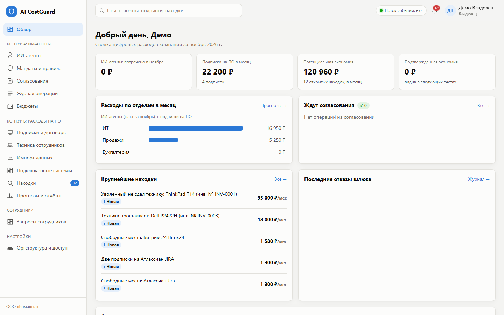
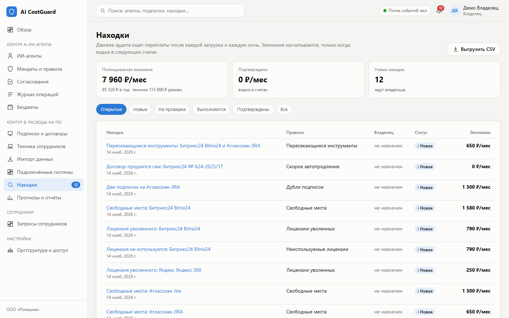
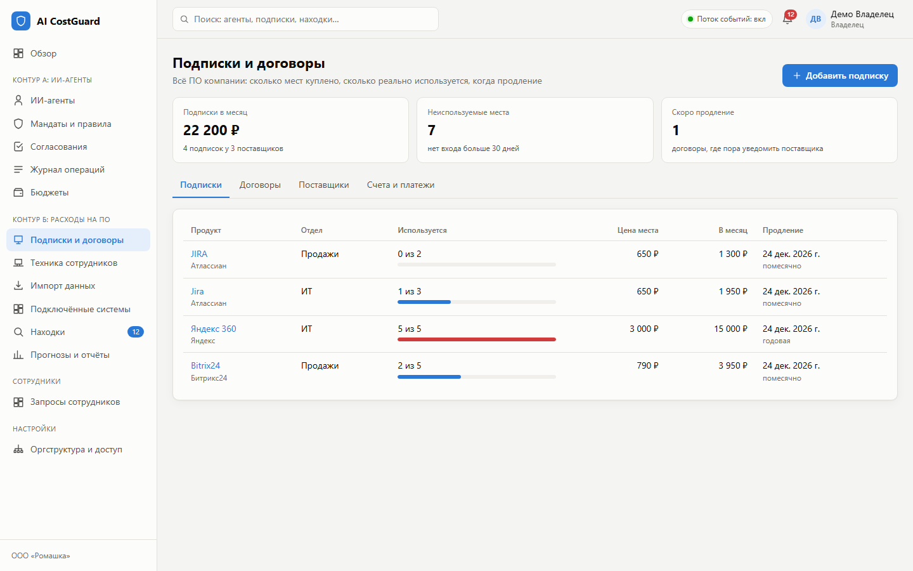
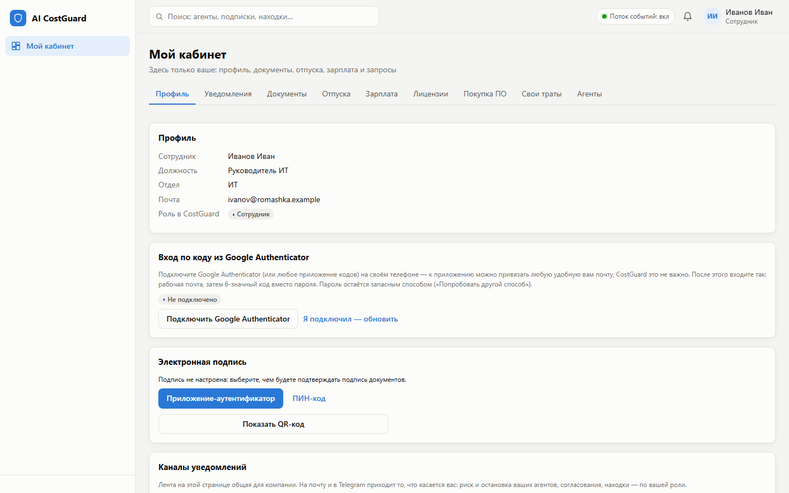

# AI CostGuard

**Одна платформа, которая держит под контролем цифровые расходы компании:** ИИ-агентов, подписки на ПО, лицензии и
технику сотрудников.

> **English summary for NEAR HACKATHON judges** is [below](#near-hackathon-english). Русское описание идёт дальше.



## Зачем это нужно

Компании платят за ИИ-агентов, которые сами тратят деньги через API, и за десятки подписок, где половина мест никому не
нужна. Узнают об этом из счёта в конце месяца. CostGuard решает это в двух контурах:

- **Контур А, ИИ-агенты.** Каждый платный вызов агента проходит через шлюз CostGuard *до* оплаты: проверяются бюджет,
  мандат (что агенту разрешено), риск и петли. Крупную операцию подтверждает человек, а подтверждение записывается в
  блокчейн NEAR, чтобы его нельзя было подделать задним числом.
- **Контур Б, ПО и техника.** CostGuard читает счета, выгрузки из 1С и банка, журналы входов Microsoft 365 и сам находит
  переплаты: дубли подписок, свободные места, лицензии уволенных, технику, которую не вернули. У каждой находки есть
  оценка экономии в рублях.

**Для кого:** финансовый директор и ИТ видят все цифровые расходы в одном месте; сотрудник в своём кабинете просит
лицензию или технику, видит свои документы, отпуска и зарплату и подписывает документы электронной подписью.

| Находки аудита с экономией | Подписки: сколько мест реально используется |
|---|---|
|  |  |

| Кабинет сотрудника |
|---|
|  |

## Как запустить у себя

Нужны **Docker Desktop** (дайте ему **8 ГБ памяти** или больше: Settings → Resources), **JDK 25**, **Python 3.12+** с
[uv](https://docs.astral.sh/uv/) и **Node.js 22+**.

```bash
git clone -b goidochka https://github.com/gggcr/ai-costguard.git
cd ai-costguard
cp .env.example .env
make demo
```

`make demo` поднимает всё: ядро, шлюз ИИ-агентов, Kafka, ClickHouse, Keycloak, разбор счетов, и заливает демо-компанию
ООО «Ромашка». Первый запуск собирает образы, это 5–10 минут.

Откройте http://localhost:3000 → «Войти по логину и паролю»:
- `demo` / `demo` — владелец компании, видит всё;
- `ivanov` / `demo` — сотрудник, видит только свой кабинет.

Находки аудита появляются примерно через минуту после запуска.

**На Windows без `make`** (PowerShell, из папки проекта) — те же шаги:

```powershell
./gradlew :core:bootJar :gateway:bootJar
docker compose -f infra/local/docker-compose.yml --env-file .env --profile demo up -d --build --wait
$env:CLICKHOUSE_URL="http://localhost:8123"; $env:CLICKHOUSE_USER="costguard"; $env:CLICKHOUSE_PASSWORD="costguard"
$env:CLICKHOUSE_ACCESS_MANAGEMENT="1"; $env:CLICKHOUSE_READER_PASSWORD="costguard-reader"
$env:KAFKA_BROKERS="kafka:29092"; $env:SCHEMA_REGISTRY_URL="http://schema-registry:8081"
uv run python schemas/clickhouse/apply.py
python tools/seed/seed.py | docker compose -f infra/local/docker-compose.yml --env-file .env exec -T postgres psql -q -v ON_ERROR_STOP=1 -U postgres -d costguard
```

Если порт 5432 занят своим PostgreSQL, перед командами задайте другой: `$env:POSTGRES_PORT="15432"` (на Windows
порты 5433–5532 часто зарезервированы системой).

Компьютер слабый (меньше 8 ГБ для Docker)? Есть облегчённый режим `make demo-lite`, около 2 ГБ: кабинет сотрудника,
оргструктура, подписки и находки работают, а шлюза агентов, Kafka и ClickHouse в нём нет, поэтому журнал операций и
графики трат агентов пустые. Его шаги без `make` — в цели `demo-lite` в [Makefile](Makefile).

## Что внутри

Java 25 и Spring Boot 4 (ядро и шлюз агентов), Python (разбор счетов и выгрузок, детектор аномалий, нотариус NEAR,
коннекторы к 1С, Bitrix24, Яндекс 360, Microsoft 365 и др.), React + TypeScript (веб-интерфейс), Rust (смарт-контракт
NEAR), PostgreSQL с изоляцией компаний на уровне строк, Kafka, ClickHouse, Redis, Keycloak, Kubernetes (Helm, Argo CD,
Terraform для Yandex Cloud). Решения описаны в [docs/adr](docs/adr) (72 записи), инструкции по эксплуатации — в
[docs/runbooks](docs/runbooks). Архитектура: [доска Miro](https://miro.com/app/board/uXjVES7uH9I=/).

Безопасность: аудит 2026-11-12/13 ([ADR 0069](docs/adr/0069-identity-by-keycloak-subject.md),
[0070](docs/adr/0070-payroll-matching.md), [0071](docs/adr/0071-security-audit-2026-11-13.md)), на каждую найденную
дыру есть тест.

## NEAR HACKATHON (English)

**What it is.** AI CostGuard controls a company's digital spend: what its AI agents pay for through APIs, and what it
pays for software subscriptions, licenses and employee hardware.

**The problem.** AI agents spend money on their own, and the company finds out from the invoice at the end of the
month. When something goes wrong, the only record of who allowed a payment is CostGuard's own database, which the
operator of CostGuard can edit.

**What NEAR does here.** Every paid agent call goes through the CostGuard gateway *before* it is paid: budget, mandate
(what the agent may buy), risk and loop checks. Each decision is written to a hash-chained journal. The NEAR contract
`contracts/notary` (Rust, near-sdk) makes that journal provable outside CostGuard:

- `anchor` stores the Merkle root of each batch of journal receipts; anyone can call `verify` with a receipt and its
  Merkle proof, without trusting CostGuard. A receipt changed after the fact no longer verifies.
- `register_mandate` stores the hash of every published version of an agent's mandate, so the rules an agent ran under
  cannot be rewritten later.
- `confirm_operation` records that a person approved a large payment (the approver is a salted hash, never a name).
- No company id or personal data goes on chain, only hashes ([ADR 0006](docs/adr/0006-notary-near.md),
  [ADR 0009](docs/adr/0009-notary-mandates-confirmations.md)).

The off-chain notary service is `apps/python/notary` (Kafka consumer, its own JSON-RPC client and ed25519 signer).

### Try the NEAR part (2 minutes, no Docker, no NEAR key)

Contract on NEAR testnet: **[`costguard-notary-11141117.testnet`](https://testnet.nearblocks.io/address/costguard-notary-11141117.testnet)**.
Anchor of a demo batch: [transaction](https://testnet.nearblocks.io/txns/HYmCtmZCcBpmPJkhjRo3sGCfe1XoJgeP5adxdEaMwTrh);
a human approval of a large payment: [transaction](https://testnet.nearblocks.io/txns/97yVpCpQQwnkQFfV8HCn9U5vYmStpcDrSD4ADbfyEgoA).
The batch with its receipts is in [tools/near/demo-batch.json](tools/near/demo-batch.json).

```bash
git clone -b goidochka https://github.com/gggcr/ai-costguard.git && cd ai-costguard
uv sync --all-packages
uv run python tools/near/demo.py verify
```

You will see the anchored batch read from the contract, a link to its transaction in the testnet explorer,
`contract verify -> True` for a real receipt, and `contract verify -> False` for the same receipt with the amount
changed to 1 RUB. With your own testnet account added as a notary, `demo.py anchor` and `demo.py confirm` write new
transactions (`NEAR_ACCOUNT_ID`, `NEAR_PRIVATE_KEY`, `NEAR_CONTRACT_ID`).

Build and test the contract: `cd contracts/notary && cargo test && cargo build --target wasm32-unknown-unknown --release`.

### Try the whole product

1. Install Docker Desktop (give it 8 GB of memory), JDK 25, Python 3.12+ with uv, Node.js 22+.
2. Run `cp .env.example .env && make demo`. The first run builds the images, 5–10 minutes.
3. Open http://localhost:3000, press **EN** in the top right corner, choose "Sign in with login and password" and
   sign in as `demo` / `demo` (company owner): you see the spend overview, audit findings with savings in rubles,
   subscriptions with unused seats, and approvals.
4. Sign in as `ivanov` / `demo` (an employee): you see only the employee cabinet.

On a machine with less than 8 GB for Docker, `make demo-lite` (about 2 GB) runs the same UI without the agent gateway,
Kafka and ClickHouse.

**RU / EN.** The interface is written in Russian (the first customers are Russian companies: 1C, Bitrix24, Yandex 360
connectors); the RU | EN switch translates all of it, including what arrives later: finding titles from the core,
names, and text people type in. Interface strings come from a dictionary (`apps/frontend/src/i18n`); other text is
translated in the browser by Chrome's on-device Translator API when it is available, otherwise names are
transliterated and unknown free text stays in Russian. Nothing is sent to a translation service.

In `make demo` the notary service is off, because it needs a funded NEAR key; the NEAR part is shown by
`tools/near/demo.py` above.

### Disclosure

- **Built during the hackathon.** The repository starts on 2026-11-02 (first commit `bd505f5`); there is no
  pre-hackathon code and no earlier version of this product on NEAR or any other chain.
- **AI-generated code.** Most of the code was written with AI coding assistants (Claude Code) under the team's
  direction and review.
- **Libraries and templates.** No project template. Main libraries: near-sdk (Rust) for the contract; Spring Boot,
  Spring Cloud Gateway and Spring Modulith (Java); Python services on confluent-kafka, httpx and cryptography; React, Vite and TypeScript for the UI; PostgreSQL, Kafka, ClickHouse, Redis, Keycloak, SeaweedFS.
  Exact versions: `gradle/libs.versions.toml`, `uv.lock`, `apps/frontend/package-lock.json`,
  `contracts/notary/Cargo.lock`.
- **License:** [MIT](LICENSE).

---

*Ниже — для разработчиков.*

## Java part of the monorepo

| Path | Gradle project | Purpose |
|---|---|---|
| `apps/backend/gateway` | `:gateway` | Agent gateway (Spring Cloud Gateway): checks, budget reserve, proxy to providers |
| `apps/backend/core` | `:core` | Core modular monolith (Spring Modulith, PostgreSQL) |
| `libs/java/platform-starter` | `:platform-starter` | Shared starter: tenant and RLS, RFC 9457 errors, tracing |
| `libs/java/events` | `:events` | Event classes generated from `schemas/avro` |
| `schemas/avro` | | Kafka contracts. The schema comes first, classes are generated |

Library versions live only in `gradle/libs.versions.toml`.

## Где что лежит

The rest of the monorepo, accepted as it is:

| Path | What it is |
|---|---|
| `apps/python/ingest` | Ingest pipeline: reads uploaded invoices, exports and bank statements (1C, MT940, CAMT.053, OFX), scans through OCR and text invoices through LLM extraction; suggests the column mapping, writes FOCUS records to `cost.records.v1` |
| `apps/python/anomaly` | Anomaly detector: spend spikes and double charges in `cost.records.v1`, reported to `findings.v1` |
| `apps/python/notary` | NEAR notary: anchors Merkle roots of journal receipts, registers mandates and confirms large operations in `contracts/notary` |
| `apps/python/connectors` | Connectors to 1C, МойСклад, Bitrix24, Яндекс 360, Jamf, Intune, Google Workspace, Okta, Entra ID, Merge, Т-Банк and a mailbox; also run as an agent inside the client's network |
| `apps/python/reports` | Spend forecasts and XLSX/PDF reports |
| `contracts/notary` | The NEAR smart contract (Rust): Merkle roots of receipt batches, mandate hashes, operation confirmations. No tenant on chain ([ADR 0006](docs/adr/0006-notary-near.md)) |
| `deploy/helm`, `deploy/argocd`, `deploy/terraform` | Kubernetes: the Helm chart, Argo CD applications for staging and prod, Yandex Cloud in Terraform |
| `libs/python/costguard-sdk`, `libs/js/costguard-sdk` | SDKs for agents: ask before spending, settle what was spent, wait for a human approval |
| `libs/python/costguard-common` | Shared code of the Python services: Kafka wire format, Schema Registry, settings |
| `apps/frontend` | The web interface (React, Vite) |
| `schemas/` | Every contract: Avro (`schemas/avro`, primary), OpenAPI exported from the code (`schemas/openapi`), ClickHouse |
| `docs/adr`, `docs/runbooks` | Architecture decisions and runbooks |
| `docs/privacy` | Personal data: where each kind is stored and for how long, and the list for the lawyer (ADR 0021–0024) |
| `docs/security` | The pentest scope: what to test, the test accounts, what not to touch |
| `tools/backup`, `deploy/backup` | Nightly encrypted backups and restores of PostgreSQL, ClickHouse and the files (ADR 0025) |

- The audit engine is a part of the core (`ai.costguard.core.findings`), not a separate service as on the board:
  the rules need the core's own data. See [ADR 0005](docs/adr/0005-audit-engine-in-core.md).
- S3 is SeaweedFS instead of MinIO: MinIO no longer publishes images. SeaweedFS serves the same S3 API on the same
  port, so nothing but `infra/local/docker-compose.yml` knows the difference.

## Быстрый старт

Рабочая ветка команды — `goidochka`: в ней собрано всё, новые изменения отправляйте туда.

```bash
git clone -b goidochka https://github.com/gggcr/ai-costguard.git
cd ai-costguard
cp .env.example .env
make demo               # инфраструктура, ядро и шлюз в Docker, демо-компания ООО «Ромашка»
make demo-lite          # на слабой машине: только кабинет и оргструктура (без Kafka, ClickHouse, шлюза), ~2 ГБ
```

Нужны JDK 25, Docker, Python 3.12+ с [uv](https://docs.astral.sh/uv/) и Node.js 20+. После `make demo`:

| Что | Где |
|---|---|
| Описание API ядра (OpenAPI) | [schemas/openapi/core.yaml](schemas/openapi/core.yaml); вживую — http://localhost:8080/v3/api-docs |
| Шлюз агентов | http://localhost:8081 |
| Keycloak | http://localhost:8180, вход `demo` / `demo` |
| Фронтенд | http://localhost:3000, вход `demo` / `demo` (Keycloak) |

Фронтенд работает с API ядра, вход через Keycloak (`apps/frontend/README.md`). Для разработки:
`cd apps/frontend && npm install && npm run dev`. Без `make` (Windows): команды цели `demo` из `Makefile` по очереди, через
`docker compose -f infra/local/docker-compose.yml --env-file .env ...`.

Тесты: `./gradlew build` (Java, нужен Docker), `uv sync --all-packages && uv run pytest` (Python),
`cd apps/frontend && npm test`, `cd contracts/notary && cargo test` (Rust).

## Build and run

Requires JDK 25 and Docker.

```bash
cp .env.example .env
make up                 # PostgreSQL, Redis, Kafka, Schema Registry, ClickHouse, S3 (SeaweedFS), Keycloak, Vault
./gradlew build
./gradlew :core:bootRun
./gradlew :gateway:bootRun
```


The application connects as an ordinary role, because a superuser bypasses row-level security, and the core
refuses to start otherwise. On an existing database, run `infra/local/postgres/fix-app-role.sql` as an
administrator; the first lines of that file show the command.

On Windows without `make`, run `docker compose -f infra/local/docker-compose.yml --env-file .env up -d --wait`.

**Local development only:** `infra/keycloak/costguard-users-0.json` holds the demo user `demo` with the password
`demo` (the tenant ООО «Ромашка» of `tools/seed`). Only the local compose stack imports it. The Helm chart, the
images and staging and prod do not carry it, and `tools/tests/test_tools.py` checks that they never will.
Staging and prod use their own Keycloak with real users.

